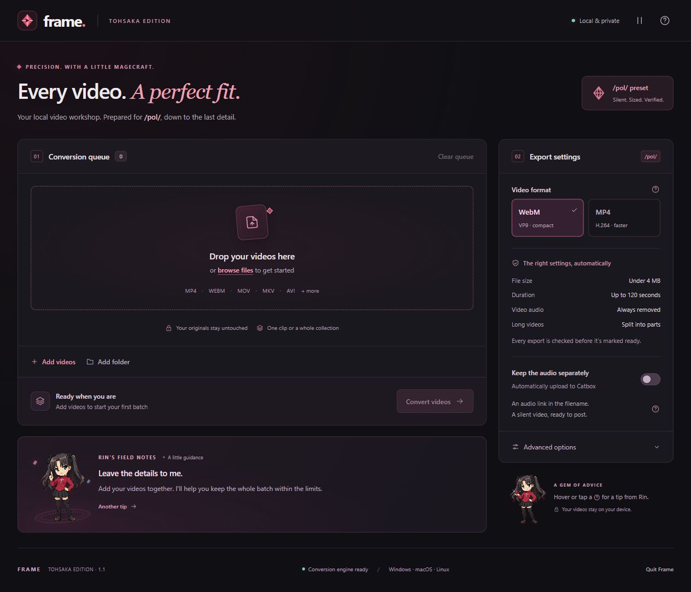

# Technical details

For the ready-to-use downloads, see the [main page](../README.md). This page covers the source version, conversion rules, and development.

## Portable packages

Platform ZIPs bundle an official Node.js runtime and a small launcher. First launch downloads FFmpeg and FFprobe directly from the pinned upstream release. Archives and executables are checked against SHA-256 hashes in `packaging/runtimes.json` before use. Completed engine files are reused offline; no global runtime installation or administrator rights are needed. FFmpeg build information and license files are stored beside the downloaded engine. Node's license is included in the package.

`npm run package:portable -- <target>` builds a user download. Targets: `win32-x64`, `darwin-arm64`, `darwin-x64`, `linux-x64`, `linux-arm64`. The builder needs Node and an archive extractor (`tar`; native Windows tar supports ZIP). `npm run test:package` extracts the host platform's package, installs its engine, runs the conversion suites with its bundled runtime, then starts and shuts down the actual packaged server.

Pushing a `v*` tag starts `.github/workflows/release.yml`. Each package is tested on its native OS and CPU before the publish job creates a GitHub release. Stable asset names keep the README's latest-download links current. No source inputs, outputs, secrets, or cached engines are packaged.

A local batch video converter for 4chan’s `/pol/`: drop in common video files, choose WebM or MP4, and get silent, verified exports. Optional Catbox uploads put a reversible audio link in the filename.

The interface is always dark, with a cold graphite and steel-blue palette, restrained crimson accents, and animated pixel-art Rin tips. Guidance appears on hover, keyboard focus, or a tap. Pause character motion from the header; system reduced-motion settings are also respected. These are unofficial fan-made Rin Tohsaka illustrations, inspired by TYPE-MOON’s Fate/stay night. Asset prompts and provenance are recorded in [`public/art/provenance.json`](../public/art/provenance.json).



[Advanced view](advanced.jpg) · [Completed batch](completed-batch.jpg)

## Source version

**No app-signing certificate, notarization, cloud backend, npm install, or account is required.** The source version is served on your computer and opened in your regular browser. It requires **Node.js 22 or newer** and **FFmpeg/FFprobe 6 or newer** with `libvpx-vp9`, `libx264`, and `libmp3lame`. Portable downloads handle these dependencies automatically.

## Start

Install [Node.js LTS](https://nodejs.org/en/download) and [FFmpeg](https://ffmpeg.org/download.html), then extract the project into a writable folder.

| System | Install FFmpeg | Launch 4chan gem converter |
| --- | --- | --- |
| Windows | `winget install --id Gyan.FFmpeg -e` | Double-click **Start 4chan gem converter.bat** |
| macOS | `brew install ffmpeg` if you use Homebrew, or use a build linked by FFmpeg | In the project folder: `sh start.sh` |
| Debian / Ubuntu | `sudo apt install ffmpeg` | In the project folder: `sh start.sh` |
| Other Linux | Install FFmpeg with your distribution’s package manager | In the project folder: `sh start.sh` |

Open a new terminal after installing dependencies so PATH changes take effect. The launchers also recognize `bin/ffmpeg` and `bin/ffprobe` (`.exe` on Windows), or you can set `FFMPEG_PATH` and `FFPROBE_PATH` to absolute executable paths. Those paths can contain spaces.

The browser opens automatically at a private `127.0.0.1` address. If it does not, open the complete URL printed by the launcher. Keep the launcher running during conversion. **Quit** or Ctrl+C stops it. Run `node server.mjs --no-open` to launch without opening a browser; `--port 4318` selects a port if needed.

This source-based approach does not require a signed native app. It does require the runtimes above. A separately packaged Windows executable or macOS app can still encounter OS reputation/quarantine checks; 4chan gem converter does not disable those protections. Catbox uses ordinary HTTPS with certificate verification enabled; users do not create or install their own certificates.

## Use

1. Add multiple videos, drag files/folders onto the drop area, or choose **Folder**.
2. Choose **WebM / VP9** or **MP4 / H.264**.
3. Use **Simple** for everyday conversion. Switch to **Advanced** for link encoding, prefix/suffix, original/random names, optional source names, Catbox userhash, long-video behavior, and output folder. Switching modes preserves your choices; a notice in Simple identifies active custom settings.
4. Optionally enable **Catbox audio** to publish the extracted audio to Catbox. This option starts off every new browser session.
5. Convert the batch. Each item shows progress, errors, verified outputs, and any audio notice.
6. Open the output folder, preview or download individual videos, copy an audio link, or download the complete ZIP.

Originals are never modified or deleted. Inputs are copied into an isolated temporary session directory; quitting or clearing the queue removes those copies. Finished outputs remain in `outputs/<batch>/`, with a `conversion-report.json` containing validation facts and full audio URLs. The queue itself is session-only. A forced process termination may leave temporary files in your system temporary directory.

The output folder can be changed in **Advanced** with an absolute path. Each conversion creates a separate batch subfolder, and existing files are not overwritten. Imported files are limited to 20 GiB each and need enough local disk space for their temporary copies.

Supported inputs include MP4, WebM, MOV, MKV, AVI, M4V, MPEG, WMV, FLV, MTS/M2TS, TS, OGV, 3GP, and VOB, subject to the codecs in the installed FFmpeg build. Corrupt, encrypted/DRM-protected, and unreadable files produce an error; other queued files continue.

## Export rules

The live [4chan board API](https://a.4cdn.org/boards.json) reported these `/pol/` limits on **2026-10-13**:

- `max_filesize`: **4,194,304 bytes**.
- `max_webm_filesize`: **4,194,304 bytes**.
- `max_webm_duration`: **120 seconds**.

MP4 attachments were also present on the [live `/pol/` board](https://boards.4chan.org/pol/). The older [API field documentation](https://github.com/4chan/4chan-API/blob/master/pages/Boards.md) labels the size field as KB, but the actual API and posting form returned the byte value above; 4chan gem converter uses the live value as evidence.

4chan gem converter deliberately uses a conservative profile: **strictly below 4,000,000 bytes**, at most 120 seconds, silent VP9 WebM or H.264 MP4, `yuv420p` (8-bit), one video stream, no subtitles/data/chapters, even dimensions, and at most 30 fps. The encoder scales to a bitrate-dependent maximum of 1280 pixels, below the commonly documented 2048-pixel video ceiling. The 2048 ceiling, codec choices, and silent-video policy are compatibility settings, not fields returned by the current board API.

The bitrate is calculated from duration and a 3,800,000-byte target with additional overhead headroom. Two-pass encoding produces predictable sizes. If the output is still too large, 4chan gem converter reduces the bitrate and tries again, up to five attempts. It then uses FFprobe to verify the actual streams, codec, pixel format, dimensions, frame rate, duration, and byte size, and FFmpeg to decode the entire result to catch corruption. Only a verified result is saved as a finished export.

Long videos are split into equal parts of at most 119 seconds, leaving room for timestamp/frame rounding. All of the source duration is retained; no silent truncation or duration-header trick is used. There is also a **Skip videos that are too long** option. Rotation and sample aspect ratio are normalized during encoding.

This profile is fixed and dated, so conversion remains offline. The app does not claim that technical validation overrides board rules, duplicate/spam filters, or future policy changes. It does not submit posts to 4chan.

## Catbox and filename settings

Audio upload is opt-in. 4chan gem converter extracts the **first audio stream**, encodes a stereo 128 kb/s MP3 for each video part, keeps a local copy, and sends it to the [documented Catbox API](https://catbox.moe/tools.php). Anyone with the uploaded link can listen. A Catbox userhash is optional and stays in memory; it is not saved in preferences or reports. Anonymous uploads are the default.

| Option | Encoding and recovery |
| --- | --- |
| Base64url (default) | UTF-8 URL → URL-safe Base64 without padding. Decode as Base64url. Compatible with the original script. |
| Base64 | Standard Base64 with padding. Any `/` is escaped as `%2F`; undo that escape before Base64 decoding. |
| Readable UTF-8 | Readable URL text, with `:` and `/` escaped as `%3A` and `%2F` for cross-platform filename safety. Percent-decode to recover the URL. |
| URL percent encoding | Percent-encoded UTF-8 URL. Percent-decode to recover the URL. |
| Hexadecimal | UTF-8 URL bytes in hex. Decode hex, then UTF-8. |

UTF-8 is a character encoding; it does not make a literal URL a legal Windows/macOS/Linux filename. The readable option therefore escapes the forbidden URL punctuation rather than substituting ambiguous characters. Encoding is reversible, **not encryption**.

Prefixes and suffixes sit outside the encoded token; optional original names sit before it. Multipart exports add `_part-01`, `_part-02`, etc. The advanced panel shows a live filename example using an example Catbox URL. Unsupported filename characters and excessive byte lengths are rejected. Filename components are bounded to 230 UTF-8 bytes; source names are sanitized and shortened, while encoded links are never truncated. Platform display limits may still shorten what 4chan shows, so the conversion report keeps the full URLs.

If a source has no audio, conversion succeeds with a notice. If extraction/upload fails, the verified video remains saved. If upload succeeds but a custom filename is too long, the video is retained under its ordinary name and the returned URL remains in the report. A cancelled network upload may already have reached Catbox; cancellation cannot recall an external upload. There is no automatic upload retry that could create duplicate public files.

## Design and architecture

The interface uses plain HTML, CSS, and JavaScript, with no CDN, web fonts, analytics, UI dependencies, or build step. Simple mode exposes the batch, format, and optional Catbox audio. Advanced mode reveals grouped controls for filenames, audio links, splitting, and output folders. Detailed requirements are in Help; Rin offers compact tips on demand. It supports keyboard focus, labeled controls, live notices, reduced motion, responsive layouts, and individual output previews.

`server.mjs` is a Node standard-library loopback server. It binds only to `127.0.0.1`, checks Host/Origin and a random session token, exposes only known static files, and passes arguments to FFmpeg without a shell. Conversion runs sequentially to avoid saturating the machine with multiple encoders. Each job uses a separate working directory and pass log. The ZIP writer streams outputs to disk before delivery. All persistent settings except the Catbox userhash are limited to harmless UI preferences; the Catbox toggle is not restored as enabled.

There is no website deployment: video processing needs the local FFmpeg process and local filesystem. The source can be shared as a ZIP and run on any supported desktop OS with its normal Node/FFmpeg installations.

## Existing PowerShell converter

The original `convert.ps1` and `run_converter.bat` are preserved as reference. Their workflow is recursive MP4 discovery, FFprobe inspection, bitrate-based downscaling, two-pass VP9 encoding, size retries, optional 128 kb/s MP3 extraction/Catbox upload, Base64url naming, then optional source deletion. The machine-specific `converter_config.txt`, input videos, and converted media remain local and are excluded from Git. For the old script only, copy `converter_config.example.txt` to `converter_config.txt` and set your folders; the GUI has its own settings and launchers.

The GUI extends that approach with other input containers, MP4 output, duration enforcement/splitting, complete output validation, cancellation, error isolation, configurable naming, local audio retention, and a professional interface. The old script did not check duration or output dimensions, treated a silent source as a failure when Catbox was enabled, and used fixed Windows paths. 4chan gem converter never imports the old script’s deletion setting or executes the original script.

## Verification

```text
npm test
npm run test:media
npm run check
```

No dependency installation is needed. Unit/API tests cover reversible names, illegal paths, size/name bounds, segmentation, cancellation, ZIP structure/CRC, and loopback authentication. Integration tests synthesize local test footage and exercise both output codecs, multiple input formats, long-video/audio segmentation, orientation, Catbox request construction and failure recovery, corruption rejection, HTTP import, conversion, download, and queue cleanup.

Catbox tests use a mock network response: no test audio or user media is published. The Windows portable package passed 13 unit/API/package checks and 9 integration checks using its own runtime and freshly downloaded engine. Package checks cover checksum failures, offline reuse, atomic extraction, and executable permissions in ZIPs. Browser verification covered Simple/Advanced switching, preserved settings, invalid-filename recovery, a real two-video MP4 batch, playback, ZIP download, contextual tips, Escape dismissal, pause/resume controls, and a 390-pixel-wide window with no horizontal overflow. A [completed batch preview](completed-batch.jpg) shows synthetic test footage. Native macOS and Linux checks run in [GitHub Actions](https://github.com/trin93755/4chan_converter/actions); the release job requires all five platform/CPU package checks to pass.

Use `node tests/make-preview.mjs` to create disposable synthetic videos under `test-results/fixtures/` for browser checks. Use `npm run package` to create a source-only distribution ZIP in `releases/`, excluding originals, configuration secrets, outputs, and test media.

References: [FFmpeg command documentation](https://ffmpeg.org/ffmpeg.html), [video filter documentation](https://ffmpeg.org/ffmpeg-filters.html), [Node downloads](https://nodejs.org/en/download).
